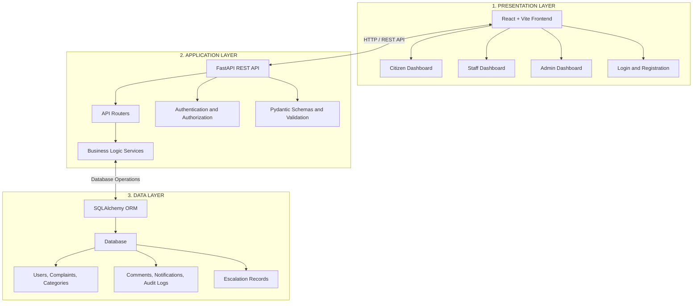

# System Architecture – Smart Complaint Management System

## 1. Overview

The Smart Complaint Management System follows a **Three-Tier Layered Architecture** with a modular backend design.

The system is divided into three major layers:

1. Presentation Layer (Frontend)
2. Application Layer (Backend)
3. Data Layer (Database)

This separation improves maintainability, scalability, modularity, and testability.

## 2. Architecture Diagram

## 3. Layer Description

### 3.1 Presentation Layer

**Technology:** React.js, Vite, JavaScript, Tailwind CSS

The presentation layer provides the user interface through which different users interact with the system.

Main components:

- Citizen Dashboard – Submit complaints and track complaint status.
- Staff Dashboard – View and manage assigned complaints.
- Admin Dashboard – Manage users, complaints, and reports.
- Login and Registration – User authentication interface.
- Notifications – Display complaint-related updates.

Location: `frontend/src/`

### 3.2 Application Layer

**Technology:** Python, FastAPI, Pydantic

The application layer handles the core functionality and business logic of the system.

Main responsibilities:

- User authentication and authorization.
- Complaint submission and management.
- Complaint categorization and triage.
- Assignment of complaints to staff.
- Complaint status management.
- Comment and attachment management.
- SLA monitoring and escalation.
- Notification management.
- Report generation.
- Audit logging.

The backend is organized into the following modules:

| Module | Responsibility |
|---|---|
| Routers | Handle HTTP requests and API endpoints |
| Services | Implement business logic |
| Schemas | Validate request and response data |
| Models | Define database entities |
| Security | Handle authentication and authorization |
| Dependencies | Provide reusable database and user dependencies |

Location: `backend/app/`

### 3.3 Data Layer

**Technology:** SQLAlchemy ORM and configured relational database

The data layer manages persistent application information.

Main entities include:

- Users
- Complaints
- Categories
- Comments
- Attachments
- Notifications
- Audit Logs
- Escalations

SQLAlchemy ORM is used to interact with the database. Database configuration and session management are maintained separately.

Location:
- `backend/app/database.py`
- `backend/app/models/`
- `backend/migrations/`

## 4. Request Processing Flow

The system follows this general request-processing sequence:

1. A user interacts with the React frontend.
2. The frontend sends an HTTP request to the FastAPI backend.
3. FastAPI routes the request to the appropriate API router.
4. Authentication and authorization checks are performed where required.
5. Request data is validated using Pydantic schemas.
6. Business logic is executed through the relevant service or router logic.
7. SQLAlchemy communicates with the database when data access is required.
8. The backend returns an appropriate response to the frontend.
9. The frontend updates the interface based on the response.

## 5. Additional Architectural Components

### Authentication and Authorization

The system uses JWT-based authentication and role-based access control to restrict access according to user roles.

The main roles are:

- Complainant (Citizen)
- Staff
- Administrator

### Complaint Categorization

A keyword-based categorization service suggests an appropriate complaint category based on the complaint description. Staff can confirm the suggested category.

### SLA Monitoring and Escalation

The scheduler supports periodic SLA monitoring and escalation processing for complaints requiring attention.

### Notification Management

The notification service manages complaint-related notifications. External email and SMS delivery depends on the corresponding provider configuration.

### Audit Logging

Important system actions are recorded to maintain traceability and support accountability.

## 6. Testing and Deployment Support

The project includes:

- Pytest-based backend testing.
- API integration tests.
- Dockerfile for backend containerization.
- GitHub Actions workflow for automated backend checks.
- Ruff for code formatting and linting.

## 7. Architecture Benefits

The selected architecture provides:

1. **Modularity:** Each component has a clearly defined responsibility.
2. **Maintainability:** Changes to one layer can be made with limited impact on other layers.
3. **Scalability:** Frontend and backend can be developed and deployed independently.
4. **Reusability:** Services and dependencies can be reused across API endpoints.
5. **Testability:** Individual modules can be tested independently.
6. **Security:** Authentication and authorization are handled centrally.

## 8. Conclusion

The Smart Complaint Management System uses a three-tier layered architecture consisting of a React-based presentation layer, a FastAPI-based application layer, and a SQLAlchemy-supported data layer.

The modular organization of routers, services, schemas, and database models makes the system easier to develop, maintain, test, and extend.

This architecture provides a structured foundation for managing complaints, tracking their progress, handling escalations, and improving communication between citizens, staff, and administrators.
