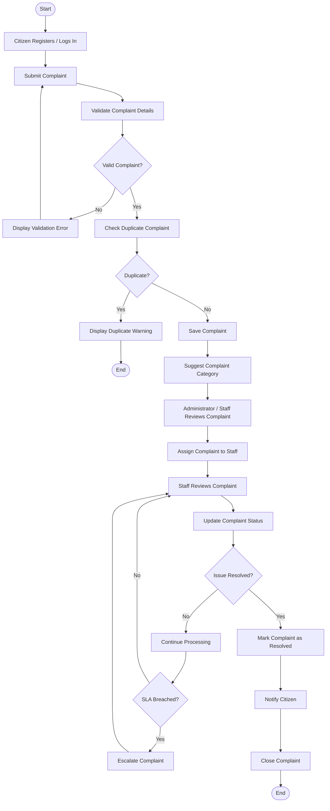

# Activity Diagram – Complaint Management Workflow

## Description
This activity diagram represents the workflow followed by the Smart Complaint Management System from complaint submission to resolution.

## Activity Explanation

1. Citizen logs in and submits a complaint.
2. The system validates the complaint details.
3. Duplicate complaints are checked.
4. A valid complaint is stored in the database.
5. The system can suggest a suitable category.
6. The complaint is reviewed and assigned to staff.
7. Staff investigates and updates the complaint status.
8. If unresolved, processing continues and SLA monitoring may trigger escalation.
9. Once resolved, the citizen is notified.
10. The complaint is closed.

