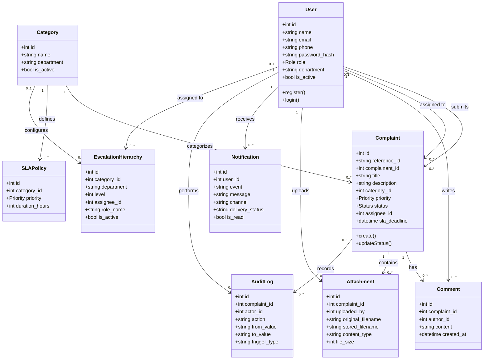

# Class Diagram – Smart Complaint Management System

## Description
This class diagram represents the major database entities and their relationships.

## Main Classes

- User: Stores user details and role information.
- Complaint: Stores complaint details, status, priority, assignment, and SLA information.
- Category: Defines complaint categories.
- Comment: Stores discussion related to complaints.
- Attachment: Stores uploaded complaint file metadata.
- Notification: Stores notification details and delivery status.
- AuditLog: Maintains a history of important system actions.
- SLAPolicy: Defines SLA durations for categories and priorities.
- EscalationHierarchy: Defines escalation levels and targets.
