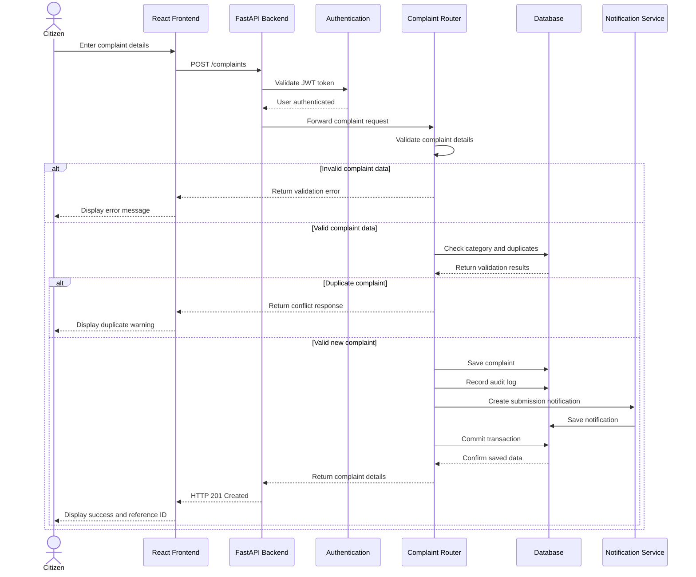

# Sequence Diagram – Complaint Submission

## Description
This diagram illustrates how a complaint is submitted, validated, stored, and acknowledged by the system.

## Sequence Explanation

1. The citizen enters complaint information in the React frontend.
2. The frontend sends a POST request to the FastAPI backend.
3. The backend verifies the user's JWT authentication.
4. The complaint router validates the submitted information.
5. The system checks the category and duplicate complaints.
6. Valid complaints are saved in the database.
7. An audit log and notification record are created.
8. The backend returns a successful response with the complaint reference ID.

**Expected response:** HTTP 201 Created for a successfully submitted complaint.
