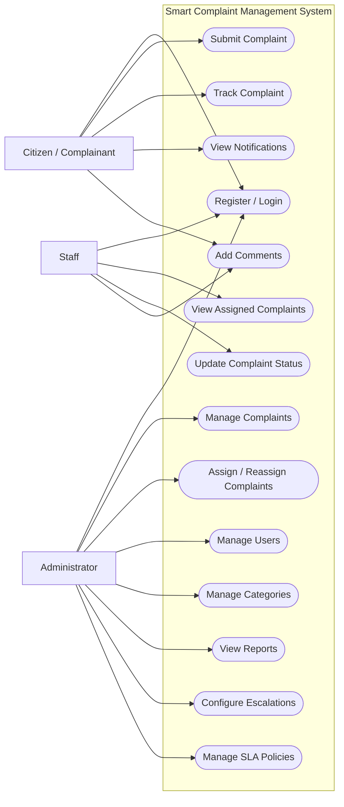

# Use Case Diagram – Smart Complaint Management System

## Description
This diagram represents the interactions between the three main actors: Citizen (Complainant), Staff, and Administrator.

## Actors

- Citizen: Registers, submits complaints, tracks progress, and receives notifications.
- Staff: Views assigned complaints, updates complaint status, and communicates through comments.
- Administrator: Manages users, complaints, assignments, categories, reports, SLA policies, and escalations.
